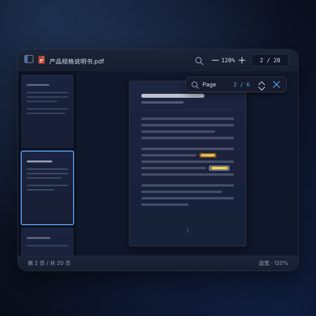

# PDF Reader

Click a PDF to open a real reader — render, page through, zoom, search; uninstall to revert.



## What it does

- 12 commands, available from the Command Palette and the Plugin Store's Features tab.
- 1 settings, editable in Settings.

## Commands

| Command | What it does |
|:--|:--|
| `pdf-reader.pageNext` — Next page | Go to the next page (same as the toolbar next button and PageDown). On the last page it returns noop honestly instead of pretending to advance. Returns { ok, sourceId, field:"currentPage", previous, value, numPages }. Requires an open PDF (no-document when none is attached). |
| `pdf-reader.pagePrev` — Previous page | Go to the previous page (same as the toolbar previous button and PageUp). On the first page it returns noop honestly. Returns the same shape as pdf-reader.pageNext. |
| `pdf-reader.gotoPage` — Go to a specific page | Jump to a page (same as pressing Enter in the page box; pages are 1-based, not zero-based indices). Out-of-range or non-integer values return ok:false with reason=out-of-range|bad-page (including the page count). Returns { ok, sourceId, field:"currentPage", previous, value, numPages }. |
| `pdf-reader.zoomIn` — Zoom in | Zoom in one step (×1.2, range 25%–400%). At the upper limit it returns noop with reason=at-max-zoom. Returns { ok, sourceId, field:"scale", previous, value, zoomMode }; scale is a multiplier (1 = 100%). |
| `pdf-reader.zoomOut` — Zoom out | Zoom out one step (÷1.2, range 25%–400%). At the lower limit it returns noop with reason=at-min-zoom. Returns the same shape as pdf-reader.zoomIn. |
| `pdf-reader.zoomTo` — Set zoom scale | Set an exact zoom multiplier (1 = 100%, range 0.25–4.0)—the general form of the toolbar's "click to return to 100%" action (pass { "scale": 1 }). Out-of-range values return ok:false with reason=out-of-range|bad-scale. Returns { ok, sourceId, field:"scale", previous, value, zoomMode }. |
| `pdf-reader.fitWidth` — Fit width | Switch zoom mode to fit-width (page width fills the reading area and recalculates on resize). If already fit-width, returns noop with reason=already-fit-width. Returns { ok, sourceId, field:"zoomMode", previous, value, scale }. |
| `pdf-reader.fitPage` — Fit page | Switch zoom mode to fit-page (the whole page is visible and recalculates on resize). If already fit-page, returns noop with reason=already-fit-page. Returns the same shape as pdf-reader.fitWidth. |
| `pdf-reader.setBackground` — Set reading background | Set the reading background: paper = paper white / night = night mode (the reading area deliberately does not follow the shell theme). Invalid values return ok:false with reason=bad-bg; already in that mode returns noop. Returns { ok, sourceId, field:"bg", previous, value }. |
| `pdf-reader.toggleSidebar` — Toggle thumbnail sidebar | Toggle the left thumbnail sidebar (same as the leftmost toolbar button). The result carries the value read back after the toggle: { ok, sourceId, field:"sidebarOpen", previous, value }—never infer state from the command title. Requires an open PDF. |
| `pdf-reader.openSearch` — Search | Open the search bar at the top of the reading area (same as the magnifier button). Idempotent: already open returns noop with reason=already-open, not a failure. It only opens the bar—close it with its own ✕ or Esc (there is no separate toggle command). This command does not type a query: search is typing-driven; to inspect results, call pdf-reader.getStatus and read searchQuery/searchHits/searchCurrent/searchScanning. Returns { ok, sourceId, field:"searchOpen", previous, value }. Requires an open PDF. |
| `pdf-reader.getStatus` — Read reader status | Read the reader's structured state—the same data as the status bar (current page/total pages/scale/zoom mode/background/sidebar and outline/search). Returns { ok, sourceId, hasDocument, currentPage, numPages, scale, zoomMode, bg, sidebarOpen, outlineCount, searchOpen, searchQuery, searchHits, searchCurrent, searchScanning, searchScannedPages, phase }; searchCurrent is the 1-based hit index (0 = no current hit), and when searchScanning is true, searchScannedPages is the number of pages scanned; outlineCount is the total outline entry count including children (0 = no outline, not a failure). With no PDF open it still succeeds: ok:true + hasDocument:false + phase="none" (empty ≠ failure); only a named source that cannot be found returns ok:false + reason=bad-source (listing available sources). |

## Settings

- **Default zoom** (`pdf-reader.defaultZoom`) — Initial zoom mode when opening a PDF; once you zoom manually, this session no longer follows it.

## Install

Open the Plugin Store, find this plugin, and click Install. For offline use, install the `.linkdesk-plugin` package from disk.

## Development

```bash
npm install
npm run dev      # preview in the dev host
npm run lint     # eslint + manifest i18n completeness
npm run verify   # full repository gate
npm run build    # produce the .linkdesk-plugin package
npm run publish  # GitHub Release + catalog entry
```

See the repository root `README.md` for the Chinese documentation and the full directory contract.
